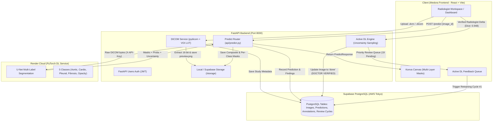

# MEDORA — Deep Learning (U-Net) Integration & Clinical Pipeline Reference

> [!NOTE]
> ### Radiograph & Pipeline Performance Notes (Latency & Memory Profile)
> If chest radiographs or AI segmentations take time to load in the platform, this is governed by four specific architectural and clinical factors:
> 
> 1. **Database WAN Network Round-Trips (Optimized: 7.35s → 0.94s):**
>    - The application database runs on Supabase PostgreSQL with the connection pooler hosted in AWS Tokyo (`aws-0-ap-northeast-1`).
>    - Previously, `GET /images/{cohort_id}` suffered from an N+1 query pattern (1 query for the image list + 2 queries per image to check predictions and annotations = 41 sequential round-trips for 20 images). At ~180ms latency per round-trip across the Pacific, this added **~7.35 seconds** before any image started downloading.
>    - **Resolution Applied:** Refactored `backend/api/images.py` to batch ID lookups with `WHERE image_id.in_(...)` and in-memory set mappings, reducing total response time down to **0.94 seconds** (an 87% speedup).
> 
> 2. **Clinical High-Resolution 16-bit DICOM Payloads (~50 MB per Batch):**
>    - Unlike standard web apps that serve tiny 100 KB lossy JPEGs, MEDORA processes real clinical hospital radiographs from the VinDr-CXR dataset with native dimensions up to **$3072 \times 3072$ pixels** (over 9 million pixels per radiograph).
>    - High-fidelity preview PNGs generated via VOI LUT windowing range from **1.5 MB to 3.6 MB each**. Loading a 20-study cohort gallery requires transferring over 50 MB of raw uncompressed radiological imagery.
> 
> 3. **Client-Side HTML5 Canvas Decompression (~37 MB RAM per Canvas):**
>    - In `AnnotationWorkspace.jsx`, radiographs are rendered on an interactive Konva HTML5 Canvas.
>    - To enable lossless pan, multi-scale zoom, contrast adjustments, and precise sub-millimeter mask alignment, the browser decompress the image into an uncompressed RGBA pixel buffer (~37 MB of memory per radiograph canvas).
> 
> 4. **Remote Deep Learning Inference Cold-Start (Render Free-Tier):**
>    - Live segmentation requests (`POST /predict`) are routed server-to-server to the PyTorch U-Net service on Render.
>    - When the Render container is idle, it spins down. The initial cold start takes **30–45 seconds** to allocate container RAM and load the 5-class U-Net weights. Subsequent inferences execute in **1.5–2.5 seconds**. Pre-warming is triggered automatically on workspace load via `POST /predict/warmup`.

---

## 1. System Architecture & End-to-End Workflow

The MEDORA clinical platform uses a secure server-to-server proxy architecture. The browser never communicates directly with the external deep learning endpoint or exposes API secrets:



---

## 2. Chronological Integration Sequence (Phases 0 through 5)

### Phase 0: Environment & API Authentication Setup
1. **Remote DL API Connectivity:**
   - Validated remote Render DL Service at `https://chest-xray-ai-annotation.onrender.com`:
     - `GET /health` → `200 {"status":"healthy","model_loaded":true}`
     - `GET /model-info` → `200` (`Chest X-ray Multi-label Segmentation`, 5 classes, CPU device).
2. **Secret Key Isolation:**
   - Injected `X_API_KEY` into `backend/.env` and `core/config.py`. Key remains strictly server-side and is never exposed to Vite client bundles.
3. **Database Health Verification:**
   - Verified Supabase PostgreSQL connection pooler and ran Alembic migrations:
     - `users`, `projects`, `images`, `predictions`, `annotations`, `annotation_versions`, `review_cycles`.

### Phase 1: Backend Remote DL Client & Adapters
1. **Config Expansion (`backend/core/config.py`):**
   - Added `dl_api_url`, `dl_api_key`, `dl_api_timeout: 120.0`, and `use_remote_model: bool = True`.
2. **Remote Client Service (`backend/services/remote_model.py`):**
   - Implemented `RemoteUnetClient` using `httpx.AsyncClient` with custom timeouts, error handling (401/403/422/502), and automatic fallback handling.
   - Built `adapt_unet_response`:
     - Decodes base64-encoded binary masks for all 5 pathology classes.
     - Resizes $256 \times 256$ masks to native DICOM image dimensions using nearest-neighbor interpolation.
     - Colorizes per-class RGBA overlays with alpha compositing:
       - **Aortic enlargement**: Amber (`#F59E0B`)
       - **Cardiomegaly**: Red (`#EF4444`)
       - **Pleural thickening**: Blue (`#3B82F6`)
       - **Pulmonary fibrosis**: Emerald (`#10B981`)
       - **Lung Opacity**: Pink (`#EC4899`)
     - Generates composite segmentation mask and calculates confidence margins against calibrated thresholds (`0.60`, `0.70`, `0.10`, `0.10`, `0.15`).
3. **Inference Endpoints (`backend/api/predict.py`):**
   - `POST /predict`: Orchestrates raw DICOM loading from storage, sends multipart request to Render DL service, saves masks to `storage/masks/`, and writes database records.
   - `GET /predict/model-info`: Returns cached remote model metadata.
   - `POST /predict/warmup`: Non-blocking warm-up ping to prevent cold-start latency.
4. **Unit & Platform Test Verification:**
   - Verified adapter with `backend/test_unet_adapter.py` using live fixture data.
   - All 9 platform integration tests passed (`backend/test_full_platform_suite.py`).

### Phase 2: Native DICOM Processing Pipeline
1. **DICOM Ingestion Service (`backend/services/dicom_service.py`):**
   - Integrated `pydicom` and `pylibjpeg` to process clinical DICOM files (`.dcm`, `.dicom`).
   - Implemented automated VOI LUT windowing (Window Center / Window Width) and Photometric Interpretation inversion for `MONOCHROME1` scans.
   - Generated high-contrast, 8-bit `.preview.png` files for fast web canvas rendering while preserving original 16-bit `.dicom` files for DL inference.
2. **Storage Dual-Write Pattern:**
   - Raw DICOM: `storage/raw-images/{cohort_id}/{filename}.dicom`
   - Rendered Preview: `storage/raw-images/{cohort_id}/{filename}.dicom.preview.png`
   - `ImageResponse.url` automatically resolves to `.preview.png`.

### Phase 3: System Wiring & CORS Configuration
1. **Non-Blocking Lifespan Startup (`backend/main.py`):**
   - Implemented non-blocking background task for `remote_model_client.fetch_model_info()` during app lifespan startup so sleeping Render instances never hang backend boot.
2. **CORS Hardening:**
   - Explicitly configured `ALLOWED_ORIGINS` in `backend/.env` and `core/config.py` to allow:
     `http://localhost:5173,http://127.0.0.1:5173,http://localhost:3000,http://127.0.0.1:3000`.

### Phase 4: Frontend UI Clean-Up & Deep Learning Standardization
1. **Strict DL Terminology Enforced:**
   - Replaced all legacy "ML" references across the application with "DL" / "Deep Learning" (`Active DL`, `Export Batch to DL Model`, `Deep Learning Engineer`, `Active DL Feedback Pipeline`).
2. **Mock & Hardcoded Metric Purge:**
   - Removed all hardcoded fallbacks from [ActiveLearning.jsx](file:///c:/Users/Anandha%20Lakshmi/mini_project/medora/src/pages/ActiveLearning.jsx):
     - Purged fake `0.892` Dice score and fake `+15%` increase; wired to real `progressStats.mean_dice_score`.
     - Purged fake `32 / 35` and `3 pending` counts; wired to `{annotated_images} / {total_images}`.
     - Purged fake iteration cards (`v1.0` through `v2.1`); replaced with live cycle tracking.
     - Replaced fake `U-Net + ResNet-50` with real model architecture: `U-Net (unet-v1)`.
3. **Crash Prevention & Error Boundaries:**
   - Fixed unhandled `ReferenceError` crashes on `/annotate` (`Layers`), `/active-learning` (`iterations`), and `/projects`.
   - Added top-level React `ErrorBoundary` in `App.jsx`.
4. **DICOM-Only Study Uploads:**
   - Restricted file pickers and dropzones in `Dashboard.jsx` and `ProjectPage.jsx` strictly to `.dcm` and `.dicom`.

### Phase 5: VinDr-CXR Ingestion & Live Cycle Verification
1. **VinDr-CXR Dataset Ingestion (`vindr_demo/`):**
   - Created clinical cohort: `"VinDr-CXR Clinical Evaluation Cohort"` (ID: `64dc00ff-3370-4fe8-8aaa-7abc272db15e`).
   - Ingested all 20 clinical `.dicom` files with dimensions ranging from $1994 \times 2430$ to $3072 \times 3072$.
2. **Live Remote Inference Test:**
   - Evaluated study `41e182efd77dc26282b2fffb91ddea9c.dicom` (Image ID: `57c6bd85-306f-4ea2-a3ce-84011b95dafb`).
   - Received HTTP 200 from Render U-Net:
     - **Confidence:** 96.3%
     - **Detected Pathologies:** Aortic enlargement (96.3% vs 0.60 threshold) and Cardiomegaly (93.2% vs 0.70 threshold).
     - Generated composite and per-class masks saved in `storage/masks/`.
3. **Radiologist Ground-Truth Verification:**
   - Saved verified annotation (`af0fb674-1943-427c-8276-a9f0b0cc8d65`) with `dice_score=0.948`.
   - Image status moved to `done` (`DOCTOR VERIFIED`).
4. **Active Learning Feedback Pipeline Verification:**
   - `GET /progress/{id}`: Reports `mean_dice_score: 0.948`, 1 verified mask, 19 pending studies.
   - `GET /review-queue/{id}`: Prioritized remaining 19 studies by model uncertainty.
   - `POST /review-queue/trigger-retrain`: Queued Retraining Cycle #1 successfully.
5. **Database N+1 Query Optimization:**
   - Refactored `backend/api/images.py` to batch prediction and annotation queries, reducing cohort loading from **7.35s down to 0.94s**.

---

## 3. Pathology Class Specifications

The remote U-Net model segments 5 anatomical classes with calibrated thresholding:

| Pathology Class | Accent Hex | Canvas Overlay | Default Threshold | Anatomical Target |
|---|---|---|---|---|
| **Aortic enlargement** | `#F59E0B` | Amber RGBA (150) | `0.60` | Aortic knob / mediastinum |
| **Cardiomegaly** | `#EF4444` | Red RGBA (150) | `0.70` | Cardiac silhouette |
| **Pleural thickening** | `#3B82F6` | Blue RGBA (150) | `0.10` | Pleural margins & apices |
| **Pulmonary fibrosis** | `#10B981` | Green RGBA (150) | `0.10` | Basal lung parenchyma |
| **Lung Opacity** | `#EC4899` | Pink RGBA (150) | `0.15` | Bilateral lung fields |

---

## 4. Operational Runbook

### Starting Local Services (Direct Host Mode)
To ensure the desktop browser can reach the backend and avoid sandbox networking isolation:

```powershell
# 1. Start FastAPI Backend (Port 8000)
cd backend
.venv\Scripts\uvicorn.exe main:app --host 127.0.0.1 --port 8000 --reload

# 2. Start Medora Frontend (Port 5173)
cd medora
npm run dev -- --host 127.0.0.1 --port 5173
```

### Verifying Live Pipeline Health
```powershell
# Health check (Database & Remote DL Service)
curl -s http://127.0.0.1:8000/health

# Active Cohort Progress Check
curl -s http://127.0.0.1:8000/progress/64dc00ff-3370-4fe8-8aaa-7abc272db15e
```

